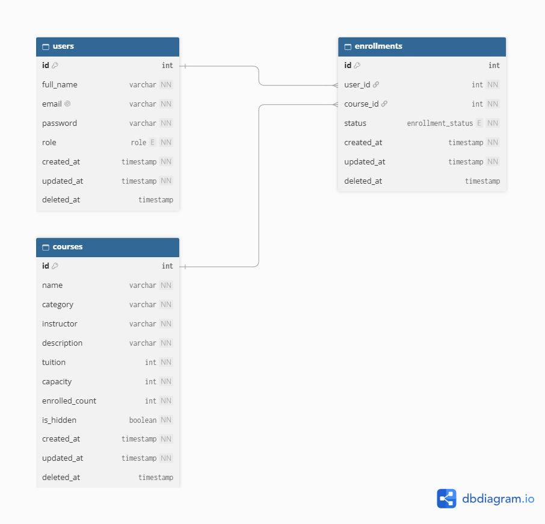

# PKS Test

Mini web-app tra cứu, quản lý và ghi danh khóa học công nghệ, phục vụ bài test Thực tập sinh Fullstack Developer của Công ty TNHH Công nghệ & Giáo dục PKS.

Hệ thống có hai vai trò: **Student** và **Admin**.

## Công nghệ

| Phần | Công nghệ |
|---|---|
| Backend | NestJS, Prisma 7, PostgreSQL, JWT, bcrypt, Zod |
| Frontend | React, Vite, TypeScript, React Router, Zustand, Tailwind CSS, Axios |

## Cấu trúc thư mục

```
pks-test/
├─ backend/    # REST API
├─ frontend/   # Giao diện
└─ docs/       # ERD, Postman Collection, ảnh kiểm thử
```

## Yêu cầu môi trường

- Node.js `18.18.0` trở lên
- PostgreSQL `17.4`
- npm

## Cài đặt và chạy

### 1. Cấu hình Database

Tạo database trống trong PostgreSQL:

```sql
CREATE DATABASE pks_db;
```

### 2. Backend

```bash
cd backend
cp .env.example .env
```

Mở `backend/.env` và điền giá trị thật (**kiểm tra lại cho khớp `.env.example`**):

```env
DATABASE_URL="postgresql://<user>:<password>@localhost:5432/pks_db?schema=public"
JWT_SECRET="<chuỗi bí mật>"
JWT_ACCESS_TOKEN_EXPIRES_IN="1h"
JWT_REFRESH_SECRET="<chuỗi bí mật>"
JWT_REFRESH_TOKEN_EXPIRES_IN="7d"
PORT=3000
```

Cài thư viện, tạo bảng và dữ liệu mẫu, rồi chạy server:

```bash
npm install
npx prisma migrate dev
npx prisma generate
npx prisma db seed
npm run start:dev
```

Backend chạy tại `http://localhost:3000`.

### 3. Frontend

```bash
cd frontend
cp .env.example .env
npm install
npm run dev
```

`frontend/.env` (**kiểm tra lại tên biến**):

```env
VITE_API_URL=http://localhost:3000
```

Frontend chạy tại `http://localhost:5173`.

## Tài khoản demo

| Vai trò | Email | Mật khẩu |
|---|---|---|
| Admin | `adminpks@mail.com` | `123456` |
| Student | `studentpks@mail.com` | `123456` |


## Chức năng

**Student:** đăng ký, đăng nhập, đăng xuất; xem danh sách khóa học dạng thẻ, tìm theo tên, lọc theo danh mục; xem chi tiết và ghi danh; xem "Khóa học của tôi".

**Admin:** thêm, sửa, ẩn/hiện, xóa mềm khóa học, cấu hình sĩ số tối đa; xem danh sách học viên đã ghi danh của từng khóa.

**Giao diện:** responsive desktop và mobile, có Loading, Empty State, Error State, nút disabled khi submit, thông báo bằng Toast.

## Tóm tắt API

| Method | Đường dẫn | Quyền | Mô tả |
|---|---|---|---|
| POST | `/auth/register` | Công khai | Đăng ký |
| POST | `/auth/login` | Công khai | Đăng nhập, trả access và refresh token |
| POST | `/auth/refresh-token` | Công khai | Cấp access token mới |
| GET | `/courses` | Công khai | Danh sách khóa học (`?search=&category=`) |
| GET | `/courses/categories` | Công khai | Danh sách danh mục |
| GET | `/courses/:id` | Công khai | Chi tiết khóa học |
| POST | `/courses/:id/enroll` | Đã đăng nhập | Ghi danh |
| GET | `/enrollments/me` | Đã đăng nhập | Khóa học của tôi |
| GET | `/admin/courses` | Admin | Danh sách khóa học  |
| POST | `/admin/courses` | Admin | Tạo khóa học |
| PATCH | `/admin/courses/:id` | Admin | Sửa, ẩn/hiện khóa học |
| DELETE | `/admin/courses/:id` | Admin | Xóa khóa học |
| GET | `/admin/courses/:id/enrollments` | Admin | Danh sách ghi danh của khóa |

Lỗi trả về theo cấu trúc thống nhất:

```json
{
  "success": false,
  "statusCode": 409,
  "message": "Khóa học đã hết chỗ",
  "path": "/courses/4/enroll",
  "timestamp": "2026-11-06T02:00:00.000Z"
}
```

Lỗi validate có thêm mảng `errors` gồm `path` và `message` của từng trường.

## Xử lý nghiệp vụ cốt lõi

- **Chặn đăng ký trùng:** kiểm tra trước để trả thông báo rõ ràng, và ràng buộc unique `(userId, courseId)` ở database làm chốt cuối.
- **Chặn quá sức chứa và Race Condition:** việc ghi danh chạy trong một Database Transaction. Số lượng đã đăng ký được tăng bằng một câu `UPDATE` có điều kiện `enrolled_count < capacity`, nên khi nhiều người cùng giành suất cuối chỉ một người thành công, người còn lại nhận lỗi hết chỗ. Nếu tạo bản ghi ghi danh thất bại thì toàn bộ transaction được rollback, dữ liệu luôn nhất quán.
- **Sức chứa:** Admin không thể đặt sức chứa thấp hơn số học viên đã ghi danh.
- **Xóa mềm:** các bảng có cột `deleted_at`; dữ liệu bị xóa chỉ bị ẩn khỏi API.
- **Ngày tháng:** định dạng `YYYY-MM-DD` theo múi giờ `Asia/Ho_Chi_Minh`.
- **Bảo mật:** mật khẩu mã hóa bcrypt (salt 12), JWT có thời hạn, phân quyền RBAC bằng guard theo role, thông tin bí mật nằm trong `.env` (không commit), có `.env.example`.

## Kiểm thử API (Postman)

Các file nằm trong thư mục `docs/`:

- `PKS TEST.postman_collection.json`
- `PKS.postman_environment.json`


## ERD

Sơ đồ thực thể nằm tại `docs/ERD.png`, gồm ba thực thể `users`, `courses`, `enrollments`.


